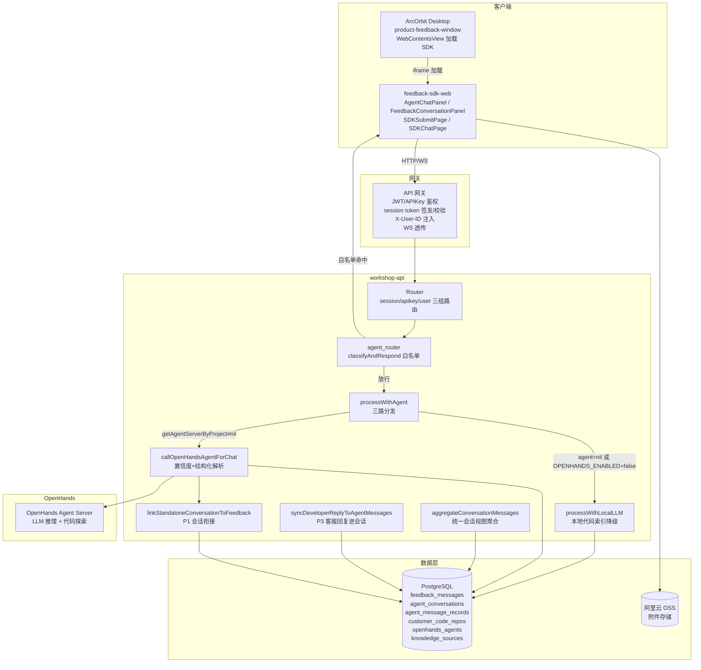
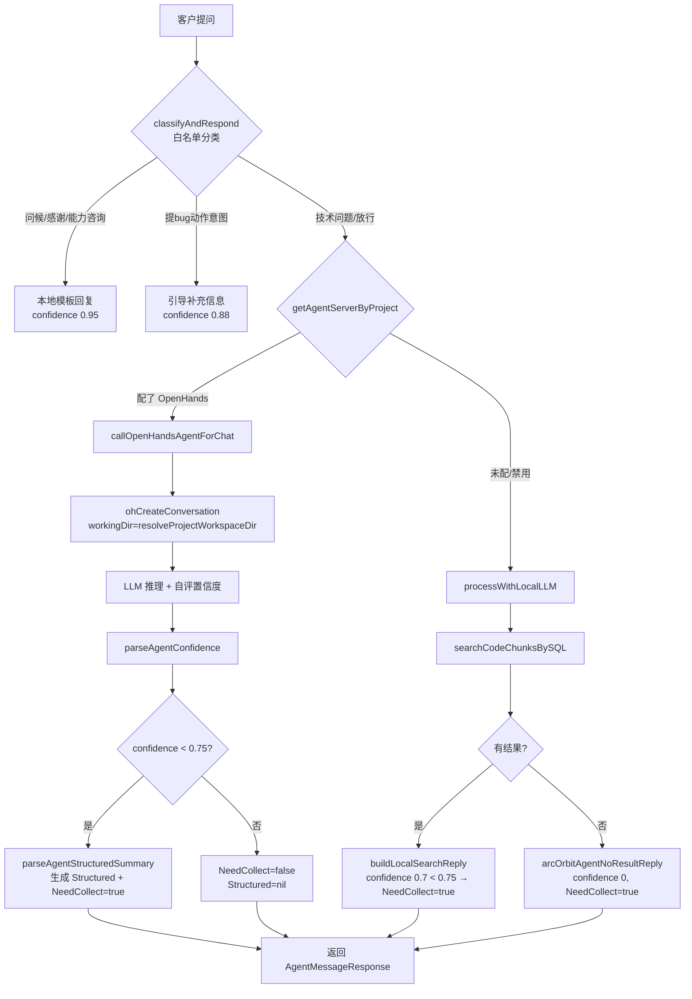
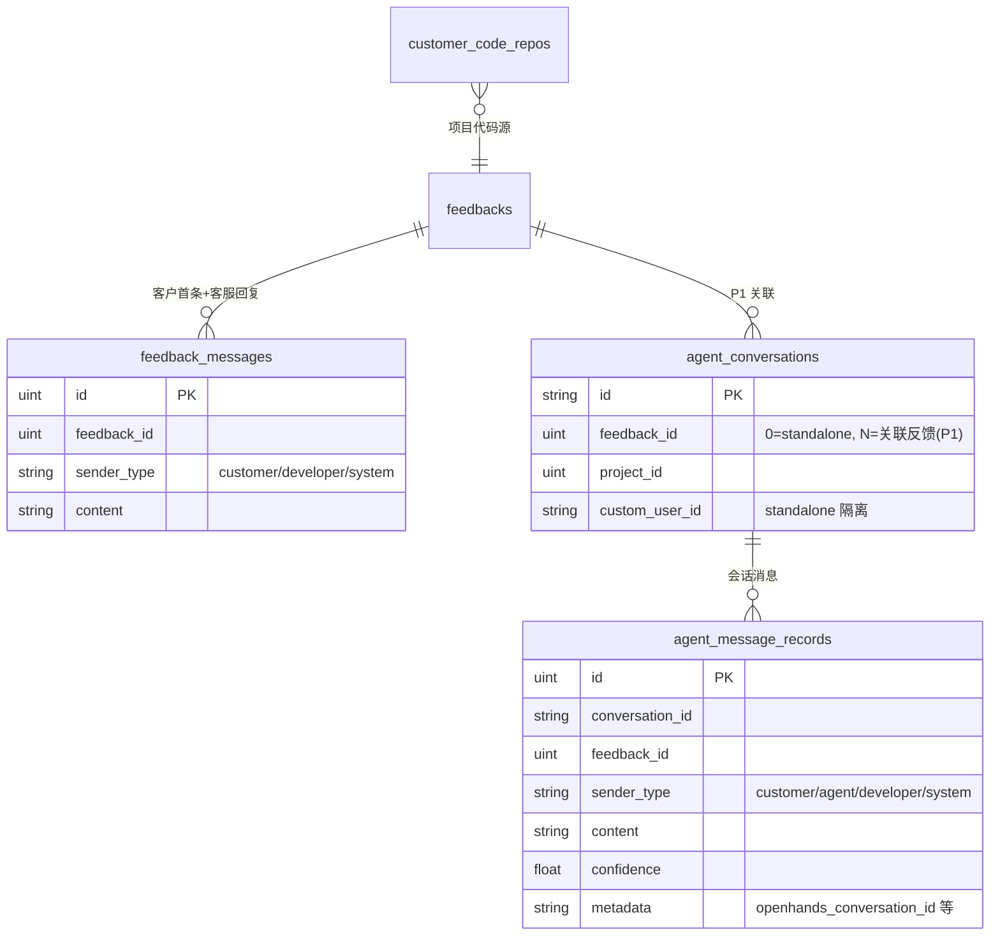
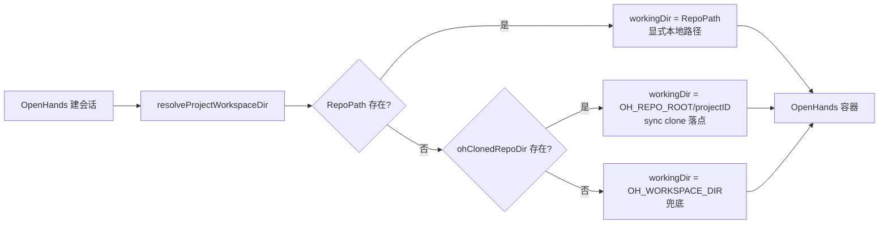
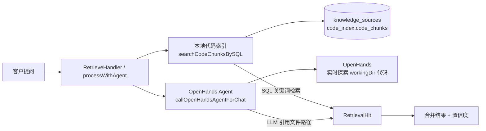

# 智能客服技术架构

> 基于迭代 1 P1-P3 实际代码绘制。描述智能客服从客户端到后端推理到数据持久化的组件关系与数据流。

## 1. 整体架构

## 2. 智能客服消息处理三层路径

## 3. 会话总线数据模型（P1-P3）

**P1 会话衔接**：提交反馈时 `agent_conversations.feedback_id` 从 0 → 新反馈 ID，咨询上下文延续。
**P3 客服回复进会话**：`syncDeveloperReplyToAgentMessages` 按 `feedback_id` 查 `agent_conversations`，写 `agent_message_records(sender=developer)`。
**P2 统一视图**：`aggregateConversationMessages` 聚合两表，按 `created_at` 排序，去重 P3 复制的 developer 消息（content 相同）。

## 4. per-project 工作区隔离（P1）

**容器卷共享**：workshop-api 和 OpenHands 容器挂载同一 `OH_REPO_ROOT` 卷，clone 的代码 Agent 才能读。

## 5. 检索双层架构

- **本地索引**：`customer_code_repos` sync 后 `runCodeIndexPipeline` 建索引，SQL 关键词检索
- **OpenHands**：Agent 在 `workingDir` 实时探索代码，LLM 推理
- **降级**：OpenHands 不可用 → 只走本地索引（confidence 0.7）
