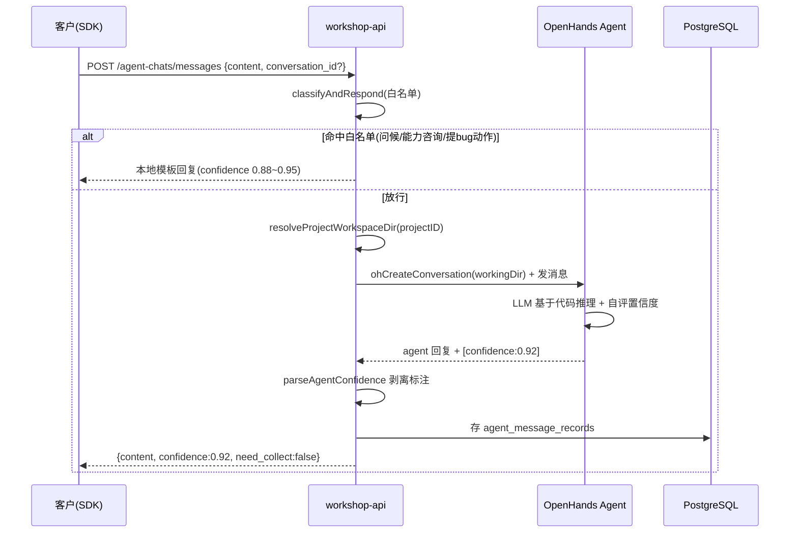
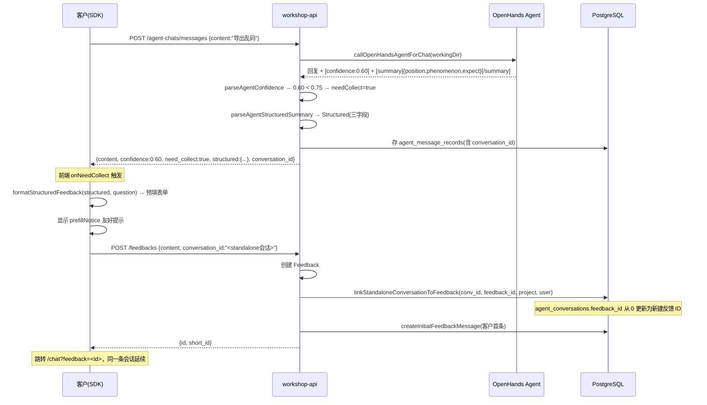
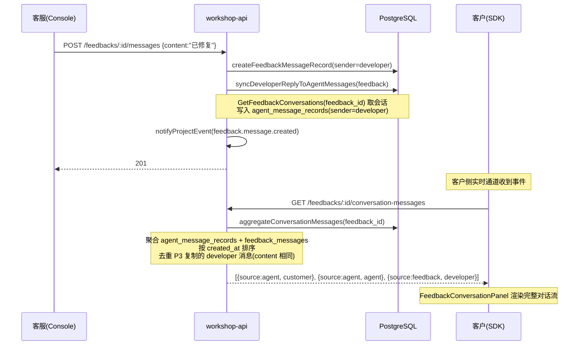
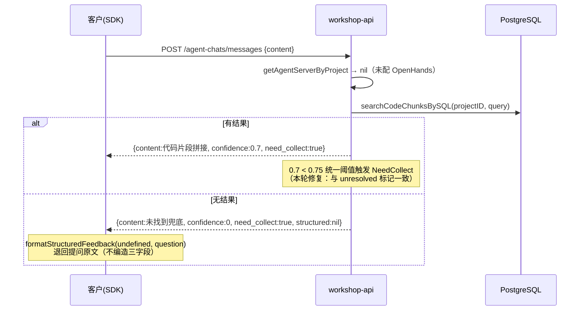
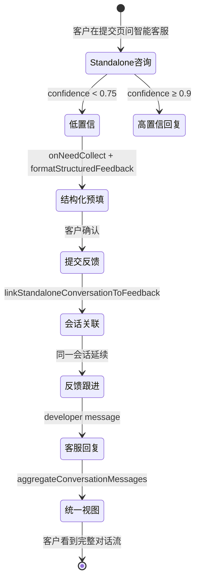

# 智能客服端到端时序图

> 基于迭代 1 P1-P3 实际代码绘制。覆盖客户提问→Agent 回答→低置信结构化预填→提交反馈关联会话→客服回复→统一会话视图的完整链路。

## 1. 智能客服提问→回答（高置信直接回复）

## 2. 低置信→结构化预填→提交反馈关联会话（P1 会话衔接）

## 3. 客服回复→进会话→统一视图（P3 + P2）

## 4. 降级路径（本地索引，OpenHands 不可用）

## 5. 关键状态流转

