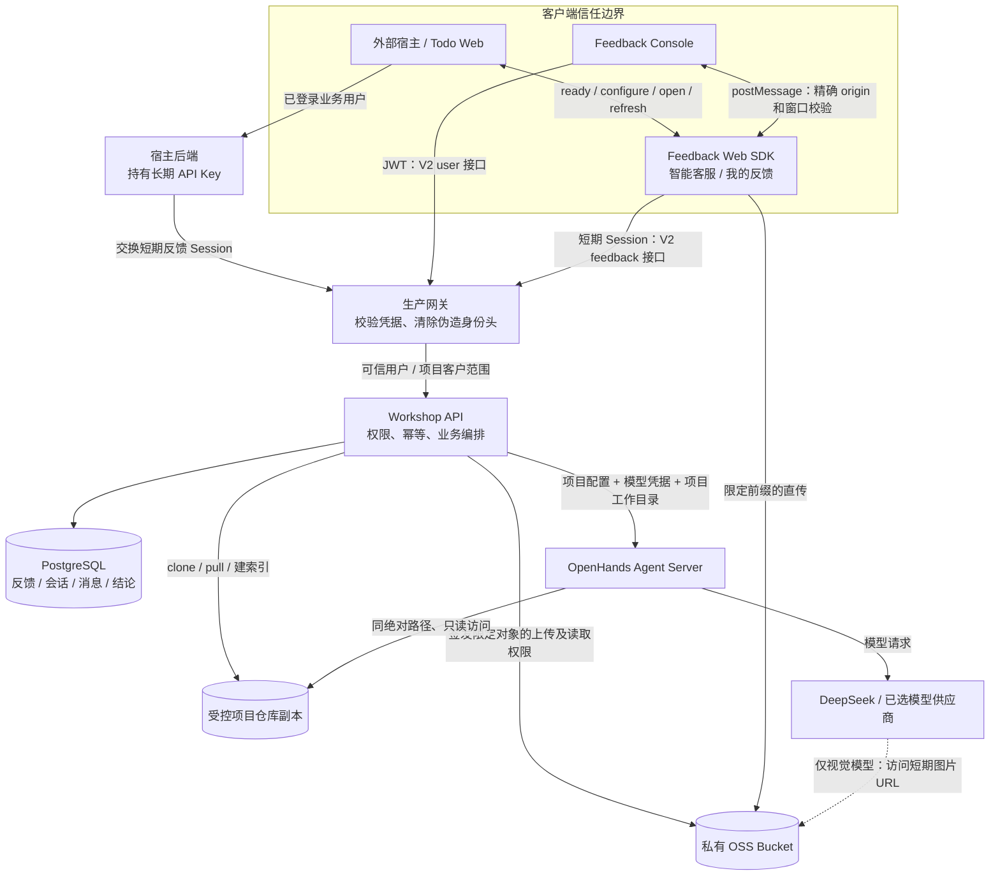
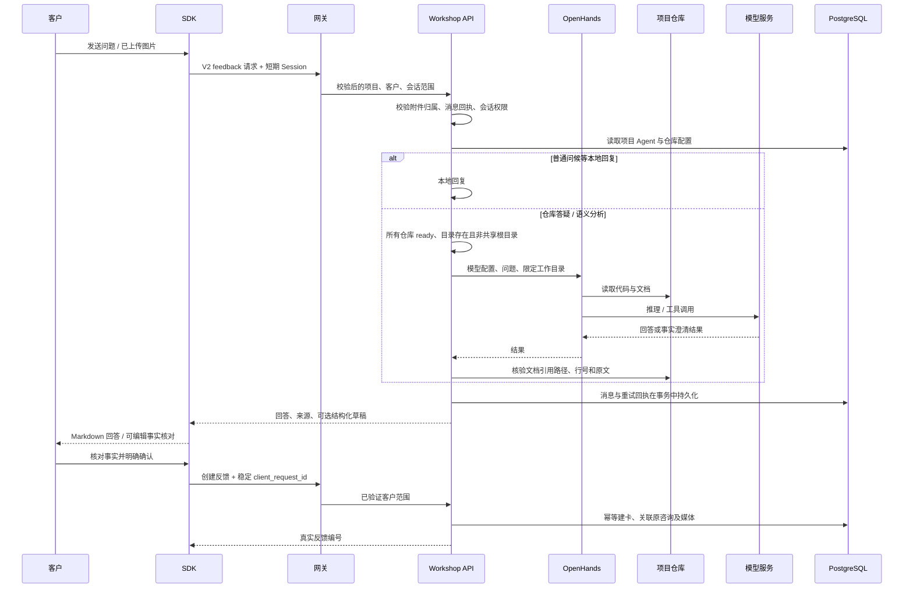
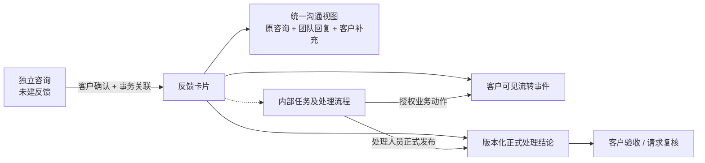
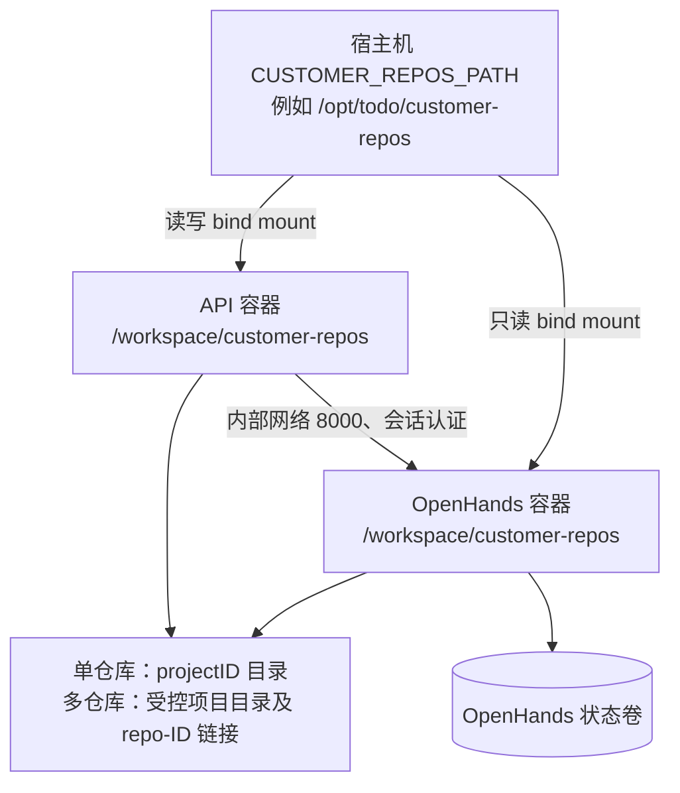

# 【2】智能客服与反馈技术架构

核对日期：2026-11-09。依据当前工作区源码，包括尚未提交的本轮修复；不是生产环境部署证明。发布步骤见[生产上线依赖与发布操作手册](生产上线依赖与发布操作手册.md)，实现约束见[技术方案](技术方案.md)。

## 1. 系统边界

本能力是嵌入业务系统的 Feedback SDK，客户通过「智能客服／我的反馈」访问，处理人员通过 Feedback Console 工作。共享 Workshop API 持有项目、反馈、会话、消息和正式结论；宿主拥有业务登录及客户身份；生产网关拥有对 HTTP 请求的身份验证与可信身份头注入。网关代码不在本仓库。

「V3 智能客服」是当前产品验证名称，不表示新增 `/workshop/v3` HTTP 协议。当前新版接口仍为 V2，兼容入口仍可承载 V1；SDK release 版本、alias/channel 与 HTTP 合约是三个不同维度。

图中的凭据由相应受信服务使用，不落入静态构建或日志。长期 API Key 直连模式仍存在，但客户身份保护弱于 Session；Todo 当前仍使用该模式，不能把它描述为已经完成 Session 接入。

## 2. 文字答疑与确认建卡

问候成功不能证明模型可用，HTTP 200 也不能证明已完成知识答疑。实际故障可能返回 `need_collect` 或兜底内容，验收必须核对回答、日志和仓库依据。客服故障时保留直接填写事实并确认提交的入口；该入口仍依赖身份、API 和数据库。

## 3. 反馈全生命周期与数据归属

| 对象 | 存储 / 职责 | 约束 |
| --- | --- | --- |
| 独立咨询 | `agent_conversations`、`agent_message_records` | 项目与客户隔离；转换后到原反馈继续沟通 |
| 反馈及沟通 | `feedbacks`、`feedback_messages`、附件表 | `project_id + custom_user_id` 范围校验；统一视图聚合原咨询，不复制成另一份聊天 |
| 发送回执 | `SupportTurn` 等幂等模型 | 同一客户、目标、请求 ID、相同负载重试返回原结果 |
| 正式结论与客户响应 | `FeedbackConclusion`、`FeedbackConclusionResponse` | 乐观版本控制、响应幂等；不由客户端直接改变内部任务状态 |
| Agent 与仓库配置 | 项目 OpenHands 配置、`customer_code_repos` | 模型 Key 加密保存；仓库状态必须对应真实同步结果 |
| 文档依据 | 当前项目仓库 Markdown / README | 服务端重新读取并校验；不信任模型给出的原文摘录 |

SDK 的「沟通记录／卡片流转／处理结论」共用详情区。Tab 在 `.sdk-workarea` 内吸顶，具有不透明主题背景；输入区与消息列表保持既有滚动边界。智能助手正文用 `react-markdown` 渲染，原始客户文字和来源摘录保持纯文本。HTML 不执行，链接经过安全 URL 处理并限制新窗口权限。

## 4. 知识工作区与生产容器

`OH_REPO_ROOT` 是各项目副本的根目录，不能等于某个项目实际仓库目录。`customer_code_repos.repo_path` 必须在 API 进程可访问，且传给 OpenHands 的绝对路径及符号链接目标在 Agent 执行环境同样存在。仓库 `ready` 不代表路径当前存在；Agent health 正常也不代表仓库或模型可用。

Compose 当前挂载整个仓库根目录，项目范围检查不能代替进程级租户沙箱。强隔离承诺需要运维另行落实每项目容器或文件系统边界。FAQ、独立文档与公共知识导入适配器尚未实现。

## 5. 时间与版本边界

- 新建 Agent 表使用 `timestamptz`；旧 `timestamp without time zone` 字段在统一迁移入口内转换，需提供原写入时区 `LEGACY_AGENT_TIMEZONE`。缺少该配置时拒绝猜测迁移。
- 同一数据库若混合 UTC 与本地墙上时间，先依据写入来源完成分段核对；不能全表加减八小时。`TZ` 或浏览器格式化不能恢复已丢失的时区信息。
- API 输出带 `Z` 或 `±HH:mm` 的时间，前端只做用户本地时间显示；统一沟通列表按真实时刻排序。
- SDK 静态资源按不可变 release 发布，通过 canary/stable channel 和明确 alias 切换。后端、Console、SDK 分别发布，前端环境变量需重新构建才能生效。

## 6. 代码入口

- [SDK 页面编排](../../../../apps/feedback-sdk-web/src/pages/SDKSupportPage.tsx)、[消息渲染](../../../../apps/feedback-sdk-web/src/components/sdk/MessageContent.tsx)、[SDK 桥](../../../../apps/feedback-sdk-web/src/lib/sdk/bridge.ts)。
- [Console 自反馈入口](../../../../apps/feedback-console/src/lib/feedbackSdk.ts)、[V2 API 地址解析](../../../../apps/feedback-console/src/lib/api/feedbackV2Client.ts)。
- [路由](../../../../services/workshop-api/router/router.go)、[反馈 Session 可信范围](../../../../services/workshop-api/middleware/feedback_session.go)、[会话签发](../../../../services/workshop-api/handler/feedback_session.go)。
- [项目工作区与 Agent 客户端](../../../../services/workshop-api/handler/openhands_client.go)、[仓库同步](../../../../services/workshop-api/handler/customer_code_repo.go)、[统一沟通视图](../../../../services/workshop-api/handler/conversation_view.go)。
- [数据库迁移入口](../../../../services/workshop-api/database/db.go)、[生产容器配置](../../../../services/workshop-api/deploy/prod/docker-compose.openhands.yml)。
